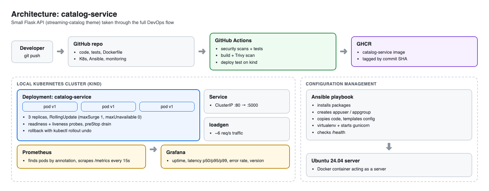
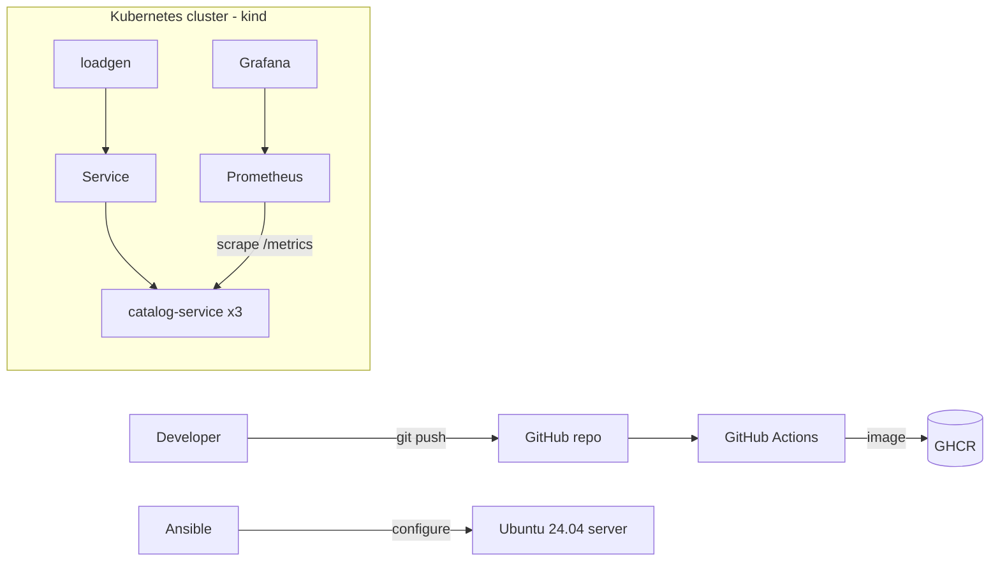
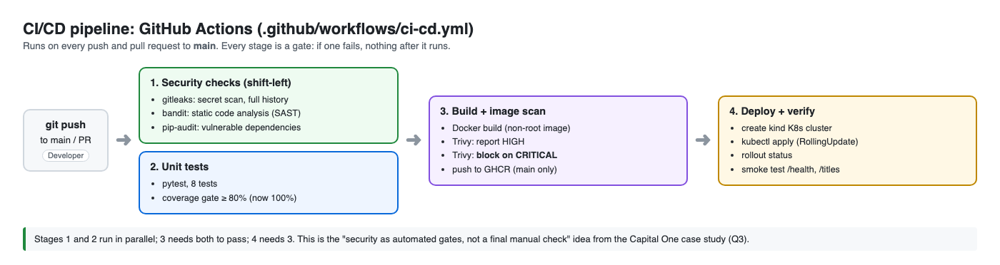
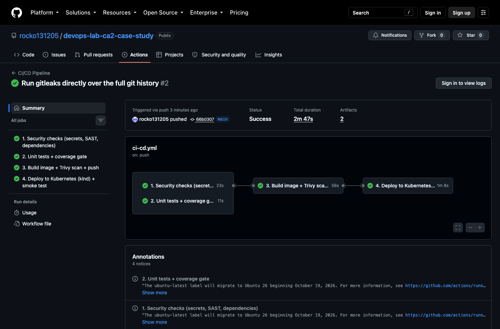
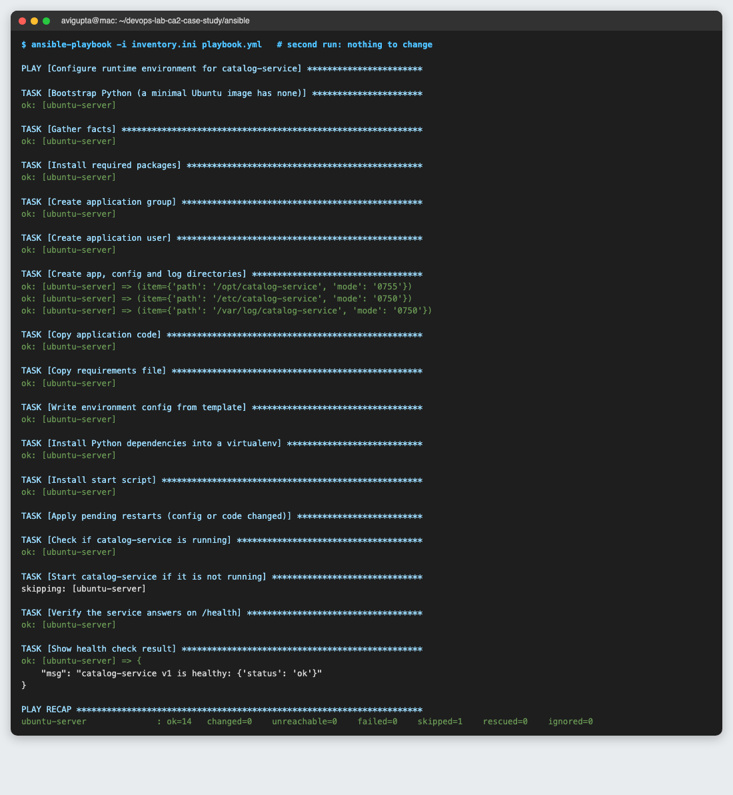
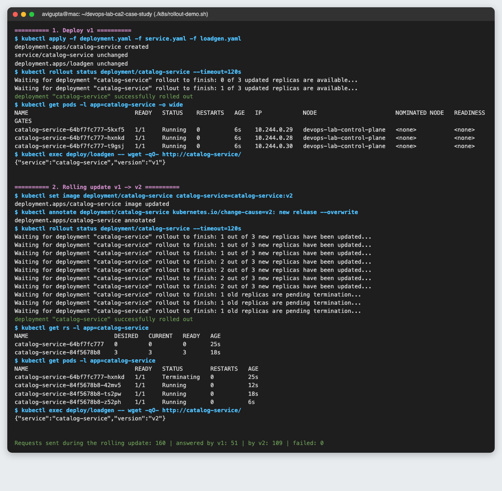
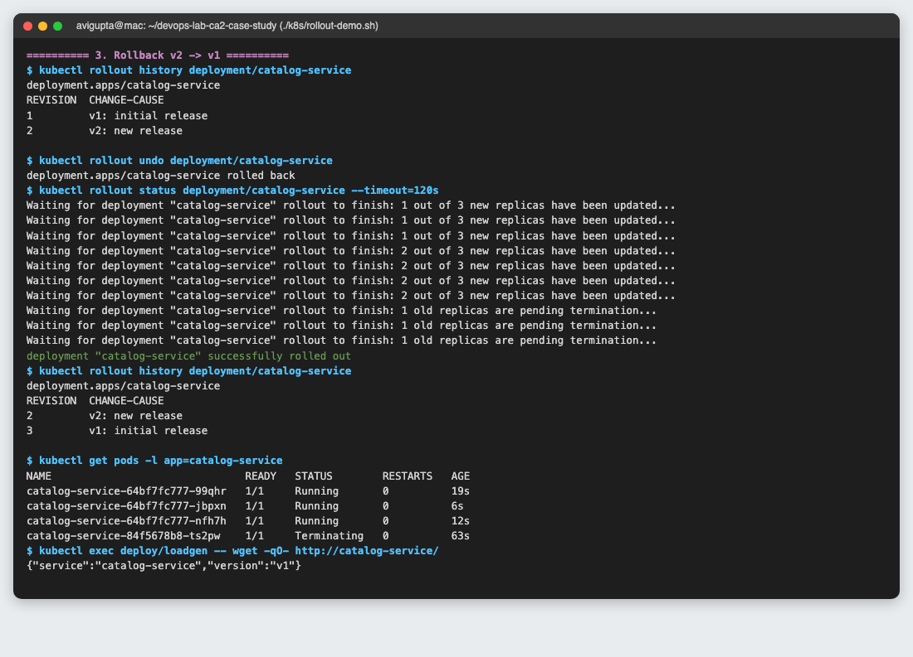
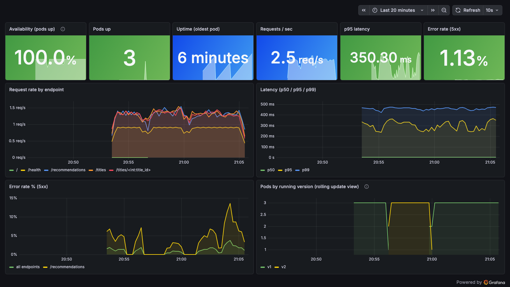

# DevOps Lab CA-II: Practical Tasks

[](https://github.com/rocko131205/devops-lab-ca2-case-study/actions/workflows/ci-cd.yml)

**Avi S Gupta** · B.Tech CSE, Sem VII · DevOps Lab CA-II (Case Study Evaluation)

In the written part of this CA I answered **Q1 (Netflix)** and **Q3 (Capital One)**. This repo is the practical part (Tasks 1–5). I took a small service through the full DevOps flow, and built each step around ideas from those two case studies:

- **Capital One (Q3), shift-left DevSecOps:** the pipeline runs security checks as automatic gates *before* anything is built or deployed.
- **Netflix (Q1), resilience:** Kubernetes rolling updates with zero failed requests, one-command rollback, and self-healing when a pod is killed (a mini Chaos Monkey). Grafana watches the "steady state".

The service is **catalog-service**, a small Flask API with a streaming-catalog theme. It lists titles, and its `/recommendations` route pretends to call a flaky downstream engine (random latency, ~5% errors), so the dashboard has real latency and error data to show.

## Task mapping

| Task | What I did | Files | Evidence |
|---|---|---|---|
| **1. Deployment strategy** | GitHub Actions pipeline: security scans → tests → build + Trivy scan → deploy to Kubernetes + smoke test | [`.github/workflows/ci-cd.yml`](.github/workflows/ci-cd.yml) | [pipeline diagram](docs/pipeline-diagram.png), [green run](docs/screenshots/task1-pipeline-run.png), [Actions tab](https://github.com/rocko131205/devops-lab-ca2-case-study/actions) |
| **2. Config management** | Ansible configures a fresh Ubuntu 24.04 server: packages, user/group, directories, code, templated config, virtualenv, starts the app, checks `/health` | [`ansible/`](ansible/) | [first run](docs/screenshots/task2-ansible-first-run.png) (11 changes), [second run](docs/screenshots/task2-ansible-second-run.png) (0 changes, idempotent), [server check](docs/screenshots/task2-server-check.png) |
| **3. Containers + orchestration** | Dockerfile (non-root), K8s Deployment + Service, rolling update v1→v2, rollback v2→v1, pod-kill self-healing | [`Dockerfile`](Dockerfile), [`k8s/`](k8s/) | [rolling update](docs/screenshots/task3-deploy-and-rolling-update.png), [rollback](docs/screenshots/task3-rollback.png), [self-healing](docs/screenshots/task3-self-healing.png) |
| **4. Monitoring** | App exposes Prometheus metrics; Prometheus scrapes pods; Grafana dashboard for uptime, latency, error rate | [`app/main.py`](app/main.py), [`monitoring/`](monitoring/) | [dashboard](docs/screenshots/task4-grafana-dashboard.png) |
| **5. Report** | This README (architecture, pipeline flow, challenges, lessons learned) + slides | [`README.md`](README.md), [`docs/slides.pdf`](docs/slides.pdf) | |

Raw terminal output from every demo is saved in [`docs/evidence/`](docs/evidence/). The terminal screenshots in `docs/screenshots/` are rendered straight from those logs.

## Architecture





## Pipeline flow (Task 1)



1. A push or pull request to `main` triggers the workflow.
2. **Security checks** run in parallel with **unit tests**:
   - `gitleaks` scans the full git history for leaked secrets
   - `bandit` does static analysis of the Python code
   - `pip-audit` checks dependencies for known CVEs
   - `pytest` runs 8 tests and fails the build if coverage drops below 80% (it's at 100%)
3. **Build:** the Docker image is built, then scanned with **Trivy**. HIGH findings are reported; any **CRITICAL** one blocks the release. On `main` the image is pushed to GitHub Container Registry, tagged with the commit SHA.
4. **Deploy:** a throwaway Kubernetes cluster (kind) is created on the runner. The image is deployed with the same `k8s/` manifests (RollingUpdate), the pipeline waits for the rollout, then smoke-tests `/health` and `/titles`.

If any stage fails, the later stages don't run, so untested or unscanned code never gets deployed.

## How to run it locally

Needs Docker, kubectl, [kind](https://kind.sigs.k8s.io/) and Python 3.10+.

```bash
# Tests
pip install -r requirements.txt -r requirements-dev.txt
pytest --cov=app

# Build two versions of the image
docker build -t catalog-service:v1 --build-arg APP_VERSION=v1 .
docker build -t catalog-service:v2 --build-arg APP_VERSION=v2 .

# Kubernetes: cluster, images, then the full rolling update / rollback / self-healing demo
kind create cluster --name devops-lab
kind load docker-image catalog-service:v1 catalog-service:v2 --name devops-lab
./k8s/rollout-demo.sh

# Monitoring: Prometheus + Grafana, then open http://localhost:3000
kubectl apply -k monitoring/
kubectl -n monitoring port-forward svc/grafana 3000:3000

# Ansible: start an Ubuntu "server" container and configure it
docker run -d --name ubuntu-server ubuntu:24.04 sleep infinity
pip install "ansible-core<2.18" && ansible-galaxy collection install community.docker
cd ansible && ansible-playbook playbook.yml

# Clean up
kind delete cluster --name devops-lab && docker rm -f ubuntu-server
```

## Screenshots

**Task 1: pipeline run (all 4 stages green)**


**Task 2: Ansible, second run shows `changed=0` (idempotent)**


**Task 3: rolling update v1 → v2: 160 requests during the update, 0 failed**


**Task 3: rollback v2 → v1**


**Task 4: Grafana dashboard.** The bottom-right panel shows the rolling update (v1 → v2) and the rollback (v2 → v1) as they happened.


## Challenges faced

- **Failed requests during the rolling update.** My first rolling update dropped 3 of 160 requests. Old pods were stopping before Kubernetes had stopped sending them traffic. I added a `preStop` hook (`sleep 5`) so each pod keeps serving while it's taken out of the Service. The re-run had **0 failures out of 160**.
- **Secret scan failing on the very first push.** The gitleaks GitHub Action scans from the parent of the first pushed commit, which doesn't exist in a brand-new repo, so it crashed. It hadn't found any leak. I replaced it with the gitleaks binary scanning the whole history; the download is checked against the published SHA-256 checksum.
- **Ansible handler killing itself.** `pkill -f "gunicorn.*app.main:app"` also matched the shell running the command, so the restart step killed itself. I switched to a PID file (`gunicorn --pid`, `pkill -F`).
- **Only 8 GB of RAM on my laptop.** The usual kube-prometheus-stack Helm chart is heavy. I wrote small Prometheus and Grafana manifests instead (about 400 MB total) and put CPU/memory limits on every pod.
- **macOS Python missing SSL certificates.** `ansible-galaxy` couldn't reach Galaxy. I pointed `SSL_CERT_FILE` at the certifi bundle.

## Lessons learned

- **Shift-left really is faster.** Trivy flagged 7 HIGH-severity, fixable vulnerabilities in the base image within a minute of building. In an old-style "security review at the end" process that would come up weeks later. The pipeline itself is also the audit trail: every scan result is in the run logs.
- **"Zero downtime" needs more than `RollingUpdate`.** It also needs readiness probes, `maxUnavailable: 0` and a graceful drain (`preStop`). Measuring the failed requests is what showed me the gap.
- **Idempotency is what makes config management safe.** The second Ansible run changed nothing, so the playbook can be re-run any time without breaking the server.
- **You can only call it resilient if you can see it.** The dashboard shows availability, latency and errors live, much like Netflix uses stream starts per second as its steady state. Killing a pod and watching it recover in seconds is a tiny version of Chaos Monkey.
- **Next steps:** fix the HIGH CVEs (newer base image), add a canary stage, and run a pod-kill chaos test inside the pipeline.

## Repository structure

```
app/main.py                  Flask service + Prometheus metrics
tests/test_app.py            8 unit tests (100% coverage)
Dockerfile                   python:3.12-slim, non-root user, gunicorn
.github/workflows/ci-cd.yml  Task 1: CI/CD pipeline
ansible/                     Task 2: playbook, inventory, templates
k8s/                         Task 3: Deployment, Service, loadgen, rollout-demo.sh
monitoring/                  Task 4: Prometheus, Grafana, dashboard JSON (kubectl apply -k)
docs/                        diagrams, screenshots, raw evidence logs, slides
```
